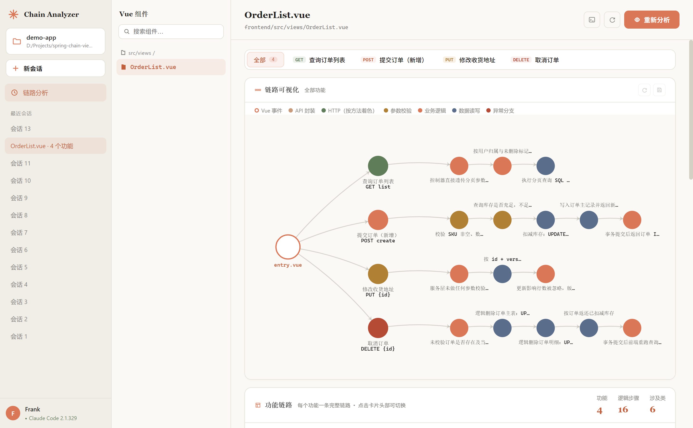
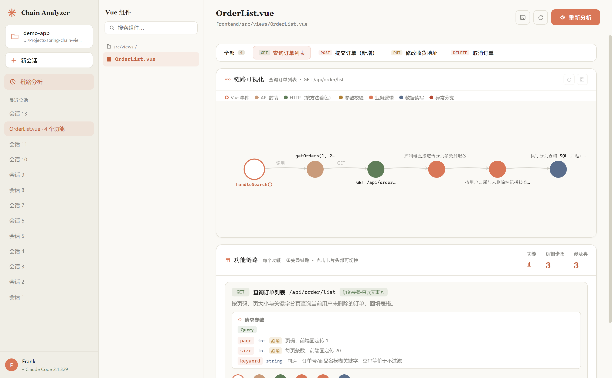

# MaiLuo · 脉络

> 看清一个按钮点下去，后端到底发生了什么。

MaiLuo 是一个 Electron 桌面工具：选中一个 Vue 组件，它会让本机 Claude Code 静态阅读前后端源码，把每个业务功能（查询 / 新增 / 修改 / 删除）从 **Vue 事件 → API 封装 → HTTP → Controller → Service → Repository → SQL** 完整拆出来，并以链路图的方式呈现。



## 它解决什么

接手一个 Vue + Spring Boot 项目时，最费时间的不是读某个文件，而是回答「这个「提交订单」按钮，底下到底走了哪些校验、动了哪几张表、事务从哪开始」。MaiLuo 把这条链一次画出来，并给出可直接点开的代码锚点（类.方法() · 行号）。

## 功能

- **按业务功能拆分**，而不是按 Controller / Service / Repository 技术分层
- **前端三段固定链路**：Vue 事件函数 → API 封装 → 实际 HTTP 方法与 URL
- **后端逻辑点**：每个点一句中文说明「做了什么」，附带 `类.方法() · 行号`
- **请求参数**按来源分组：path / query / body，标注必填与含义
- **关键机制**：`@Transactional` 事务边界、异常中断分支、乐观锁冲突等
- **链路可视化**：全部功能泳道总览 + 单功能横向链路，支持拖拽节点、保存布局
- **多会话**：不同组件各开一个会话，结果与终端输出都可恢复
- **实时终端**：Claude Code 的读取 / 搜索动作与输出实时可见



## 技术栈

| 层 | 选型 |
| --- | --- |
| 桌面壳 | Electron 33 |
| 渲染层 | Vue 3 + Vite 5 |
| 可视化 | ECharts 5（graph，layout: none） |
| 分析引擎 | 本机 Claude Code CLI（`claude -p --output-format stream-json`） |

## 快速开始

环境要求：Node.js 20+，已安装并登录 `claude` CLI（`claude --version` 能输出版本号）。

```bash
npm install
npm run dev        # 开发模式（Vite HMR + Electron）
npm run build      # 构建主进程 / preload / 渲染层到 out/
npm run preview    # 以构建产物启动
```

> `scripts/dev.mjs` 会清掉从终端继承的 `ELECTRON_RUN_AS_NODE`，否则 Electron 会退化成纯 Node 进程，主进程 ESM 加载失败。

## 使用流程

1. 点击左上角项目卡片，填入项目根路径（包含前后端代码的目录），保存。工具会自动探测 `frontend` / `backend` 子目录。
2. 在中间栏选择一个 `.vue` 组件。
3. 点击「开始分析」，右侧终端会实时显示 Claude Code 的读取过程；完成后主区域出现该组件的功能页签与链路图。
4. 点击页签切换单个功能，点击链路卡头部可在图中聚焦，卡片可展开查看完整逻辑点与分支。

## 工作原理

1. 主进程拼装分析提示词（目标组件 + 后端目录 + JSON 契约结构）。
2. `spawn('claude', ['-p', '--output-format', 'stream-json', '--allowedTools', 'Read,Glob,Grep'])`，仅授予只读工具，**不会修改项目任何文件**。
3. 解析 stream-json 事件，把文本与工具调用实时推给渲染层。
4. 从最终消息中提取 JSON 契约（容错：代码块从后往前试、裸 JSON 花括号配对、尾逗号容忍），归一化后渲染。

## 目录结构

```
electron/
  main/
    index.mjs       窗口、IPC、开发期求值/截图钩子
    analyzer.mjs    提示词、claude CLI 子进程、契约解析与归一化
    project.mjs     项目探测、Vue 组件扫描
    persist.mjs     配置 / 会话 / 布局读写
  preload/index.mjs contextBridge API
src/
  App.vue           三栏布局
  store.js          全局状态、会话、分析流程
  chain.js          链路图数据构建与配色
  components/       Sidebar / ComponentPanel / DetailPanel / ChainGraph / ChainCard / AgentTerminal / ConfigModal
samples/demo-app/   用于演示的 Vue + Spring Boot 小项目
SCHEMA.md           分析结果 JSON 数据模型
```

## 数据存放

配置、会话、布局保存在 Electron `userData` 目录（Windows 为 `%APPDATA%\MaiLuo`）。从旧名称升级时首次启动会自动从 `%APPDATA%\spring-chain-view` 迁移这三个 JSON 文件。

## 说明

- 分析质量取决于所选模型与项目可读性；契约解析失败时会提示重试，并保留终端原始输出。
- 本工具只读源码，不上传代码、不写项目文件。
